<!-- =====================================================================
     Traducción al español de «A Gentle Introduction to Graph Neural
     Networks» (Distill, 2021), para estudio personal.
     Original: CC BY 4.0. Se tradujo el texto completo, sin resumir.
     Para compilar: quarto render gnn-intro-traduccion.qmd
     ===================================================================== -->

```{=latex}
\title{\textbf{Una introducción amable a las redes neuronales de grafos}\\[4pt]
       \large Traducción al español de «A Gentle Introduction to Graph Neural Networks»}
\author{Benjamin Sanchez-Lengeling, Emily Reif, Adam Pearce y Alexander B. Wiltschko\\
        \small Google Research · \textit{Distill}, 2 de septiembre de 2021 · \texttt{doi:10.23915/distill.00033}}
\date{}
\begingroup\setlength{\parskip}{0pt}
\maketitle
\endgroup
\kern-25pt
```

> **Nota del traductor.** Traducción completa del artículo original (<https://distill.pub/2021/gnn-intro/>), publicado bajo licencia Creative Commons Atribución 4.0 (CC BY 4.0); esta traducción se distribuye bajo la misma licencia, con atribución a sus autores. El original contiene muchas figuras **interactivas** que no pueden reproducirse en PDF: se indican como «[Figura interactiva en el original]» con su pie traducido, y conviene verlas en la página web mientras se estudia. Las figuras estáticas sí se incluyen. Las notas al margen del original aparecen como bloques «Nota al margen». Las citas se numeran en orden de aparición y la lista completa está al final. Se conservan en inglés, entre paréntesis, los términos técnicos de uso habitual (por ejemplo, *embedding*, *pooling*). Solo se corrigieron erratas tipográficas evidentes en tres fórmulas, señaladas en su lugar.

*Las redes neuronales se han adaptado para aprovechar la estructura y las propiedades de los grafos. Exploramos los componentes necesarios para construir una red neuronal de grafos y motivamos las decisiones de diseño que hay detrás de ellos.*

**[Figura interactiva en el original]** *Pase el cursor sobre un nodo del diagrama para ver cómo acumula información de los nodos que lo rodean a lo largo de las capas de la red.*

Este artículo es una de dos publicaciones de Distill sobre redes neuronales de grafos. Consulte *Understanding Convolutions on Graphs* [1] para entender cómo las convoluciones sobre imágenes se generalizan de forma natural a convoluciones sobre grafos.

Los grafos están en todas partes; los objetos del mundo real suelen definirse en términos de sus conexiones con otras cosas. Un conjunto de objetos, y las conexiones entre ellos, se expresan de forma natural como un *grafo*. Los investigadores han desarrollado redes neuronales que operan sobre datos de grafos (llamadas redes neuronales de grafos, o GNN, por sus siglas en inglés) desde hace más de una década [2]. Desarrollos recientes han aumentado sus capacidades y su poder expresivo. Estamos empezando a ver aplicaciones prácticas en áreas como el descubrimiento de antibacterianos [3], las simulaciones físicas [4], la detección de noticias falsas [5], la predicción del tráfico [6] y los sistemas de recomendación [7].

Este artículo explora y explica las redes neuronales de grafos modernas. Dividimos este trabajo en cuatro partes. Primero, vemos qué tipo de datos se formulan de manera más natural como un grafo, y algunos ejemplos comunes. Segundo, exploramos qué hace que los grafos sean diferentes de otros tipos de datos, y algunas de las decisiones especializadas que tenemos que tomar al usar grafos. Tercero, construimos una GNN moderna, recorriendo cada una de las partes del modelo, comenzando con las innovaciones históricas de modelado en el área. Avanzamos gradualmente desde una implementación mínima hasta un modelo de GNN del estado del arte. Cuarto y último, ofrecemos una «zona de juego» (*playground*) de GNN en la que puede experimentar con una tarea y un conjunto de datos reales para formarse una intuición más sólida de cómo cada componente de un modelo de GNN contribuye a las predicciones que hace.

Para empezar, establezcamos qué es un grafo. Un grafo representa las relaciones (*aristas*) entre una colección de entidades (*nodos*).

**[Figura interactiva en el original]** *Tres tipos de atributos que podemos encontrar en un grafo; pase el cursor para resaltar cada atributo. Otros tipos de grafos y de atributos se exploran en la sección «Otros tipos de grafos».*

Para describir con más detalle cada nodo, cada arista o el grafo completo, podemos almacenar información en cada una de estas piezas del grafo.

**[Figura interactiva en el original]** *Se puede almacenar información en forma de escalares o de *embeddings* (representaciones vectoriales) en cada nodo (izquierda) o arista (derecha) del grafo.*

Además, podemos especializar los grafos asociando una dirección a las aristas (*dirigidas*, *no dirigidas*).

{width=85%}

Los grafos son estructuras de datos muy flexibles y, si ahora esto parece abstracto, lo haremos concreto con ejemplos en la siguiente sección.

# Los grafos y dónde encontrarlos

Probablemente ya está familiarizado con algunos tipos de datos de grafos, como las redes sociales. Sin embargo, los grafos son una representación de datos extremadamente poderosa y general; mostraremos dos tipos de datos que quizá no pensaría que pueden modelarse como grafos: imágenes y texto. Aunque resulte contraintuitivo, se puede aprender más sobre las simetrías y la estructura de las imágenes y del texto viéndolos como grafos, y construir una intuición que ayudará a entender otros datos de grafos menos parecidos a una rejilla, que discutiremos más adelante.

## Las imágenes como grafos

Normalmente pensamos en las imágenes como rejillas rectangulares con canales de imagen, y las representamos como arreglos (por ejemplo, 244x244x3 números de punto flotante). Otra manera de pensar en las imágenes es como grafos con estructura regular, donde cada píxel representa un nodo y está conectado mediante una arista a los píxeles adyacentes. Cada píxel que no está en el borde tiene exactamente 8 vecinos, y la información almacenada en cada nodo es un vector de 3 dimensiones que representa el valor RGB del píxel.

Una forma de visualizar la conectividad de un grafo es mediante su *matriz de adyacencia*. Ordenamos los nodos, en este caso cada uno de los 25 píxeles de una imagen sencilla de 5x5 de una carita sonriente, y llenamos una matriz de $n_{nodes} \times n_{nodes}$ con una entrada si dos nodos comparten una arista. Observe que cada una de las tres representaciones siguientes son vistas diferentes del mismo dato.

**[Figura interactiva en el original]** *Haga clic en un píxel de la imagen para cambiar su valor y ver cómo cambia la representación como grafo.*

## El texto como grafo

Podemos digitalizar el texto asociando índices a cada carácter, palabra o *token*, y representando el texto como una secuencia de estos índices. Esto crea un grafo dirigido sencillo, en el que cada carácter o índice es un nodo y está conectado mediante una arista al nodo que le sigue.

**[Figura interactiva en el original]** *Edite el texto para ver cómo cambia la representación como grafo.*

Por supuesto, en la práctica no es así como suelen codificarse el texto y las imágenes: estas representaciones como grafo son redundantes, ya que todas las imágenes y todo el texto tendrán estructuras muy regulares. Por ejemplo, las imágenes tienen una estructura en bandas en su matriz de adyacencia porque todos los nodos (píxeles) están conectados en una rejilla. La matriz de adyacencia del texto es solo una línea diagonal, porque cada palabra se conecta únicamente con la palabra anterior y con la siguiente.

> **Nota al margen.** Esta representación (una secuencia de *tokens* de caracteres) se refiere a la forma en que el texto suele representarse en las RNN; otros modelos, como los *Transformers*, pueden considerarse como modelos que ven el texto como un grafo completamente conectado, en el que aprendemos la relación entre los *tokens*. Vea más en «Redes de atención sobre grafos».

## Datos con forma de grafo en el mundo real

Los grafos son una herramienta útil para describir datos con los que quizá ya esté familiarizado. Pasemos a datos con una estructura más heterogénea. En estos ejemplos, el número de vecinos de cada nodo es variable (a diferencia del tamaño fijo de vecindad de las imágenes y el texto). Estos datos son difíciles de formular de cualquier otra forma que no sea un grafo.

**Las moléculas como grafos.** Las moléculas son los bloques de construcción de la materia, y están formadas por átomos y electrones en un espacio 3D. Todas las partículas interactúan, pero cuando un par de átomos queda fijo a una distancia estable el uno del otro, decimos que comparten un enlace covalente. Distintos pares de átomos y de enlaces tienen distancias diferentes (por ejemplo, enlaces simples o dobles). Es una abstracción muy conveniente y común describir este objeto 3D como un grafo, donde los nodos son átomos y las aristas son enlaces covalentes [8]. Aquí hay dos moléculas comunes y sus grafos asociados.

**[Figura interactiva en el original]** *(Izquierda) Representación 3D de la molécula de citronelal. (Centro) Matriz de adyacencia de los enlaces de la molécula. (Derecha) Representación de la molécula como grafo.*

**[Figura interactiva en el original]** *(Izquierda) Representación 3D de la molécula de cafeína. (Centro) Matriz de adyacencia de los enlaces de la molécula. (Derecha) Representación de la molécula como grafo.*

**Las redes sociales como grafos.** Las redes sociales son herramientas para estudiar patrones en el comportamiento colectivo de personas, instituciones y organizaciones. Podemos construir un grafo que represente grupos de personas modelando a los individuos como nodos y sus relaciones como aristas.

**[Figura interactiva en el original]** *(Izquierda) Imagen de una escena de la obra «Otelo». (Centro) Matriz de adyacencia de la interacción entre los personajes de la obra. (Derecha) Representación de estas interacciones como grafo.*

A diferencia de los datos de imagen y de texto, las redes sociales no tienen matrices de adyacencia idénticas.

**[Figura interactiva en el original]** *(Izquierda) Imagen de un torneo de karate. (Centro) Matriz de adyacencia de la interacción entre las personas de un club de karate. (Derecha) Representación de estas interacciones como grafo.*

**Las redes de citas como grafos.** Los científicos citan habitualmente el trabajo de otros científicos al publicar artículos. Podemos visualizar estas redes de citas como un grafo, donde cada artículo es un nodo y cada arista *dirigida* es una cita entre un artículo y otro. Además, podemos añadir información sobre cada artículo en cada nodo, como un *embedding* de palabras del resumen (véanse [9], [10], [11]).

**Otros ejemplos.** En visión por computadora, a veces queremos etiquetar objetos en escenas visuales. Podemos entonces construir grafos tratando estos objetos como nodos y sus relaciones como aristas. Los modelos de aprendizaje automático, el código de programación [12] y las ecuaciones matemáticas [13] también pueden formularse como grafos, donde las variables son nodos y las aristas son operaciones que tienen estas variables como entrada y como salida. Puede encontrar el término «grafo de flujo de datos» (*dataflow graph*) en algunos de estos contextos.

La estructura de los grafos del mundo real puede variar mucho entre distintos tipos de datos: algunos grafos tienen muchos nodos con pocas conexiones entre ellos, o viceversa. Los conjuntos de datos de grafos pueden variar ampliamente (tanto dentro de un mismo conjunto de datos como entre conjuntos) en el número de nodos, de aristas y en la conectividad de los nodos.

| Conjunto de datos | Dominio | Grafos | Nodos | Aristas | Aristas por nodo (grado): mín. | media | máx. |
|---|---|---|---|---|---|---|---|
| karate club | Red social | 1 | 34 | 78 | | 4.5 | 17 |
| qm9 | Moléculas pequeñas | 134k | ≤ 9 | ≤ 26 | 1 | 2 | 5 |
| Cora | Red de citas | 1 | 23,166 | 91,500 | 1 | 7.8 | 379 |
| Wikipedia links, English | Grafo de conocimiento | 1 | 12M | 378M | | 62.24 | 1M |

: Estadísticas resumidas de grafos encontrados en el mundo real. Los números dependen de las decisiones de caracterización (*featurization*). Pueden encontrarse estadísticas y grafos más útiles en KONECT [14]. (Las celdas vacías también están vacías en el original.)

# ¿Qué tipos de problemas tienen datos estructurados como grafos?

Hemos descrito algunos ejemplos de grafos en el mundo real, pero ¿qué tareas queremos realizar con estos datos? Hay tres tipos generales de tareas de predicción sobre grafos: a nivel de grafo, a nivel de nodo y a nivel de arista.

En una tarea a nivel de grafo, predecimos una sola propiedad para un grafo completo. En una tarea a nivel de nodo, predecimos alguna propiedad para cada nodo de un grafo. En una tarea a nivel de arista, queremos predecir la propiedad o la presencia de aristas en un grafo.

Para los tres niveles de problemas de predicción descritos arriba (a nivel de grafo, de nodo y de arista), mostraremos que todos los problemas siguientes pueden resolverse con una sola clase de modelo, la GNN. Pero primero, hagamos un recorrido más detallado por las tres clases de problemas de predicción sobre grafos, y demos ejemplos concretos de cada una.

> **Nota al margen.** Hay otras tareas relacionadas que son áreas de investigación activa. Por ejemplo, podríamos querer generar grafos, o explicar predicciones sobre un grafo. Pueden encontrarse más temas en la sección «Entrando en detalle».

## Tarea a nivel de grafo

En una tarea a nivel de grafo, nuestro objetivo es predecir la propiedad de un grafo completo. Por ejemplo, para una molécula representada como un grafo, podríamos querer predecir a qué huele la molécula, o si se unirá a un receptor implicado en una enfermedad.

**[Figura interactiva en el original]** *(Esquema de una tarea a nivel de grafo: un grafo de entrada recibe una sola etiqueta.)*

Esto es análogo a los problemas de clasificación de imágenes con MNIST y CIFAR, donde queremos asociar una etiqueta a una imagen completa. Con texto, un problema similar es el análisis de sentimiento, donde queremos identificar el estado de ánimo o la emoción de una oración completa de una sola vez.

## Tarea a nivel de nodo

Las tareas a nivel de nodo se ocupan de predecir la identidad o el papel de cada nodo dentro de un grafo.

Un ejemplo clásico de problema de predicción a nivel de nodo es el club de karate de Zach [15]. El conjunto de datos es un solo grafo de una red social formado por individuos que juraron lealtad a uno de dos clubes de karate tras una ruptura política. Según la historia, una disputa entre el Sr. Hi (instructor) y John H (administrador) crea un cisma en el club de karate. Los nodos representan a los practicantes de karate y las aristas representan las interacciones entre estos miembros fuera del karate. El problema de predicción es clasificar si un miembro dado se vuelve leal al Sr. Hi o a John H después de la disputa. En este caso, la distancia de un nodo al instructor o al administrador está muy correlacionada con esta etiqueta.

**[Figura interactiva en el original]** *A la izquierda tenemos las condiciones iniciales del problema; a la derecha, una posible solución, en la que cada nodo se ha clasificado según la alianza. El conjunto de datos puede usarse en otros problemas de grafos, como el aprendizaje no supervisado.*

Siguiendo la analogía con las imágenes, los problemas de predicción a nivel de nodo son análogos a la *segmentación de imágenes*, en la que intentamos etiquetar el papel de cada píxel de una imagen. Con texto, una tarea similar sería predecir la categoría gramatical de cada palabra de una oración (por ejemplo, sustantivo, verbo, adverbio, etc.).

## Tarea a nivel de arista

El problema de predicción restante en los grafos es la *predicción de aristas*.

Un ejemplo de inferencia a nivel de arista es la comprensión de escenas en imágenes. Más allá de identificar objetos en una imagen, los modelos de aprendizaje profundo pueden usarse para predecir la relación entre ellos. Podemos formular esto como una clasificación a nivel de arista: dados nodos que representan los objetos de la imagen, queremos predecir cuáles de estos nodos comparten una arista o cuál es el valor de esa arista. Si queremos descubrir conexiones entre entidades, podríamos considerar el grafo completamente conectado y, con base en su valor predicho, podar aristas para llegar a un grafo disperso.

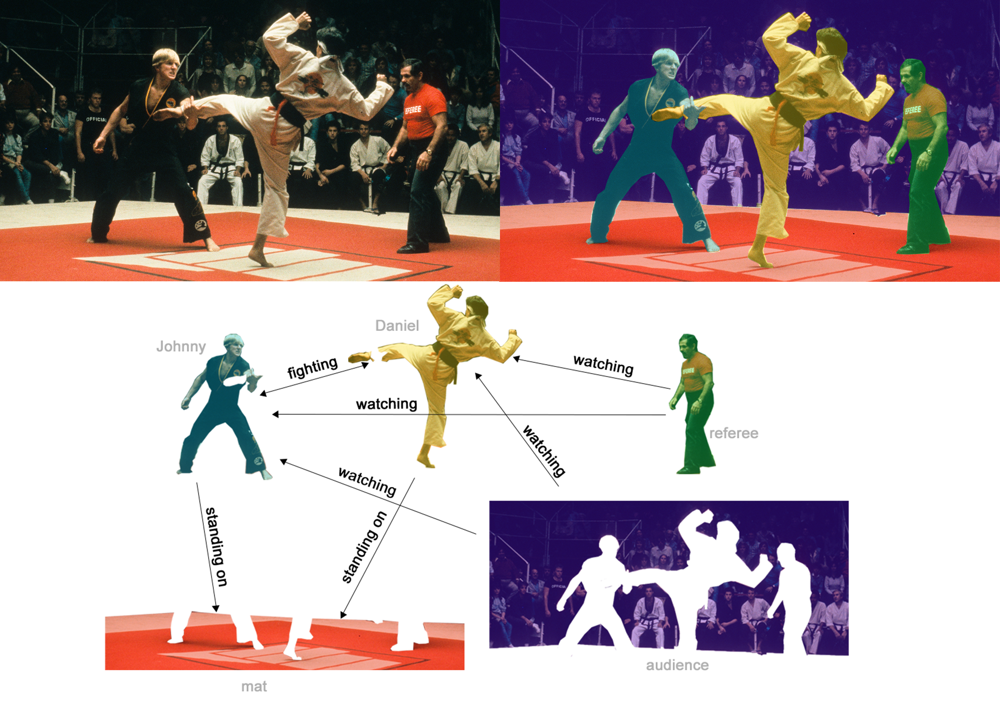{width=55%}

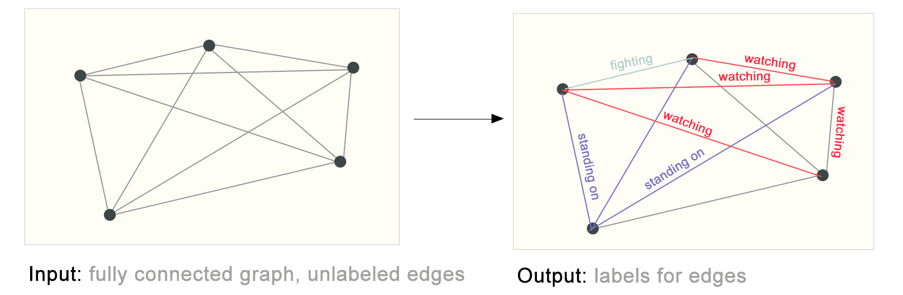{width=75%}

# Los retos de usar grafos en aprendizaje automático

Entonces, ¿cómo resolvemos estas distintas tareas sobre grafos con redes neuronales? El primer paso es pensar en cómo representaremos los grafos para que sean compatibles con las redes neuronales.

Los modelos de aprendizaje automático normalmente toman como entrada arreglos rectangulares o con forma de rejilla. Así que no es inmediatamente intuitivo cómo representarlos en un formato compatible con el aprendizaje profundo. Los grafos tienen hasta cuatro tipos de información que potencialmente querremos usar para hacer predicciones: nodos, aristas, contexto global y conectividad. Los tres primeros son relativamente sencillos: por ejemplo, con los nodos podemos formar una matriz de características de nodos $N$ asignando a cada nodo un índice $i$ y almacenando la característica de $node_i$ en $N$. Aunque estas matrices tienen un número variable de ejemplos, pueden procesarse sin técnicas especiales.

Sin embargo, representar la conectividad de un grafo es más complicado. Quizá la opción más obvia sería usar una matriz de adyacencia, ya que se convierte fácilmente en tensor. Sin embargo, esta representación tiene algunos inconvenientes. En la tabla de conjuntos de datos de ejemplo vemos que el número de nodos de un grafo puede ser del orden de millones, y que el número de aristas por nodo puede ser muy variable. A menudo, esto lleva a matrices de adyacencia muy dispersas, que son ineficientes en espacio.

Otro problema es que hay muchas matrices de adyacencia que pueden codificar la misma conectividad, y no hay garantía de que estas distintas matrices produzcan el mismo resultado en una red neuronal profunda (es decir, no son invariantes a permutaciones).

> **Nota al margen.** Aprender operaciones invariantes a permutaciones es un área de investigación reciente [16] [17].

Por ejemplo, el grafo de Otelo de antes puede describirse de forma equivalente con estas dos matrices de adyacencia. También puede describirse con cualquier otra permutación posible de los nodos.

::: {layout-ncol=2}
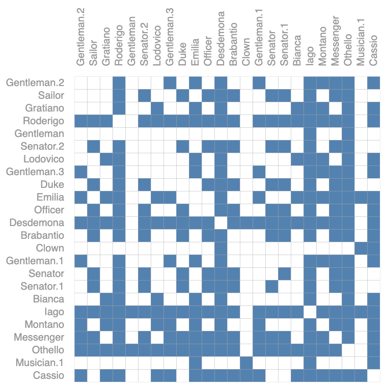{width=75%}

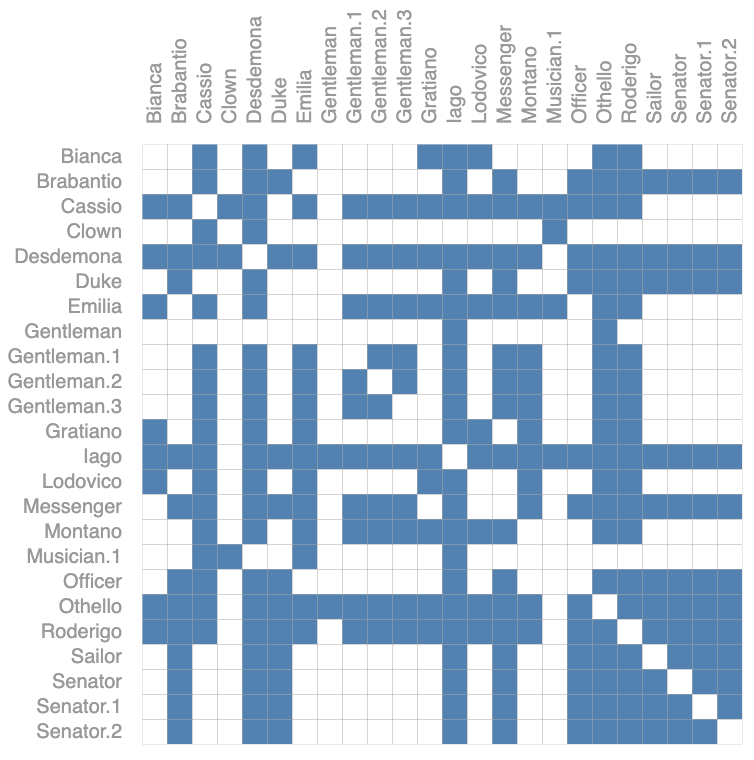{width=75%}
:::

*Dos matrices de adyacencia que representan el mismo grafo.*

El ejemplo siguiente muestra todas las matrices de adyacencia que pueden describir este pequeño grafo de 4 nodos. Esto ya es un número considerable de matrices de adyacencia; para ejemplos más grandes, como Otelo, el número es inmanejable.

**[Figura interactiva en el original]** *Todas estas matrices de adyacencia representan el mismo grafo. Haga clic en una arista para eliminarla o en una «arista virtual» para añadirla, y las matrices se actualizarán en consecuencia.*

Una forma elegante y eficiente en memoria de representar matrices dispersas es mediante *listas de adyacencia*. Estas describen la conectividad de la arista $e_k$ entre los nodos $n_i$ y $n_j$ como una tupla (i,j) en la k-ésima entrada de una lista de adyacencia. Como esperamos que el número de aristas sea mucho menor que el número de entradas de una matriz de adyacencia ($n_{nodes}^2$), evitamos el cálculo y el almacenamiento de las partes desconectadas del grafo.

> **Nota al margen.** Otra forma de decirlo es con la notación O grande: es preferible tener $O(n_{edges})$ en lugar de $O(n_{nodes}^2)$.

Para hacer concreta esta noción, podemos ver cómo podría representarse la información de distintos grafos bajo esta especificación:

**[Figura interactiva en el original]** *Pase el cursor y haga clic sobre las aristas, los nodos y el marcador global del grafo para ver y cambiar las representaciones de los atributos. De un lado tenemos un grafo pequeño y del otro, la información del grafo en una representación tensorial.*

Cabe señalar que la figura usa valores escalares por nodo, arista y global, pero la mayoría de las representaciones tensoriales prácticas tienen vectores por cada atributo del grafo. En lugar de un tensor de nodos de tamaño $[n_{nodes}]$, trabajaremos con tensores de nodos de tamaño $[n_{nodes}, node_{dim}]$. Lo mismo ocurre con los demás atributos del grafo.

# Redes neuronales de grafos

Ahora que la descripción del grafo está en un formato matricial invariante a permutaciones, describiremos el uso de redes neuronales de grafos (GNN) para resolver tareas de predicción sobre grafos. **Una GNN es una transformación optimizable sobre todos los atributos del grafo (nodos, aristas, contexto global) que preserva las simetrías del grafo (invariancias a permutaciones).** Vamos a construir GNN usando el marco de «redes neuronales de paso de mensajes» (*message passing neural network*) propuesto por Gilmer et al. [18], con los esquemas de la arquitectura *Graph Nets* introducidos por Battaglia et al. [19]. Las GNN adoptan una arquitectura de «grafo de entrada, grafo de salida» (*graph-in, graph-out*), lo que significa que estos tipos de modelo aceptan un grafo como entrada, con información cargada en sus nodos, aristas y contexto global, y transforman progresivamente estos *embeddings*, sin cambiar la conectividad del grafo de entrada.

## La GNN más sencilla

Con la representación numérica de los grafos que construimos arriba (con vectores en lugar de escalares), ya estamos listos para construir una GNN. Comenzaremos con la arquitectura de GNN más sencilla, una en la que aprendemos nuevos *embeddings* para todos los atributos del grafo (nodos, aristas, global), pero en la que todavía no usamos la conectividad del grafo.

> **Nota al margen.** Por simplicidad, los diagramas anteriores usaban escalares para representar los atributos del grafo; en la práctica, los vectores de características, o *embeddings*, son mucho más útiles.

Esta GNN usa un perceptrón multicapa (MLP) separado (o su modelo diferenciable favorito) sobre cada componente de un grafo; a esto lo llamamos una capa de GNN. Para cada vector de nodo, aplicamos el MLP y obtenemos un vector de nodo aprendido. Hacemos lo mismo para cada arista, aprendiendo un *embedding* por arista, y también para el vector de contexto global, aprendiendo un solo *embedding* para todo el grafo.

> **Nota al margen.** También podría llamarse un bloque de GNN, porque contiene varias operaciones o capas (como un bloque de ResNet).

{width=95%}

Como es habitual con los módulos o capas de las redes neuronales, podemos apilar estas capas de GNN.

Como una GNN no actualiza la conectividad del grafo de entrada, podemos describir el grafo de salida de una GNN con la misma lista de adyacencia y el mismo número de vectores de características que el grafo de entrada. Pero el grafo de salida tiene *embeddings* actualizados, ya que la GNN ha actualizado cada una de las representaciones de nodos, aristas y contexto global.

## Predicciones de una GNN mediante agrupamiento de información (*pooling*)

Hemos construido una GNN sencilla, pero ¿cómo hacemos predicciones en cualquiera de las tareas descritas arriba?

Consideraremos el caso de la clasificación binaria, pero este marco puede extenderse fácilmente al caso multiclase o de regresión. Si la tarea es hacer predicciones binarias sobre los nodos, y el grafo ya contiene información en los nodos, el enfoque es directo: para cada *embedding* de nodo, se aplica un clasificador lineal.

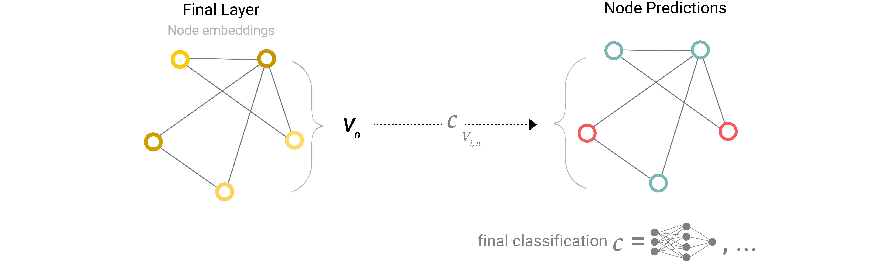{width=95%}

> **Nota al margen.** Podríamos imaginar una red social en la que queremos anonimizar los datos de los usuarios (nodos) no usándolos, y usando solo datos relacionales (aristas). Un caso de este escenario es la tarea de nodos que especificamos en la subsección «Tarea a nivel de nodo». En el ejemplo del club de karate, esto sería usar solo el número de reuniones entre personas para determinar la alianza con el Sr. Hi o con John H.

Sin embargo, no siempre es tan sencillo. Por ejemplo, podría tener información del grafo almacenada en las aristas, pero ninguna información en los nodos, y aun así necesitar hacer predicciones sobre los nodos. Necesitamos una forma de reunir información de las aristas y dársela a los nodos para la predicción. Podemos hacerlo mediante *agrupamiento* (*pooling*). El agrupamiento procede en dos pasos:

1\. Para cada elemento que se va a agrupar, se *reúnen* (*gather*) cada uno de sus *embeddings* y se concatenan en una matriz.

2\. Los *embeddings* reunidos se *agregan* después, normalmente mediante una operación de suma.

> **Nota al margen.** Para una discusión más a fondo sobre las operaciones de agregación, vaya a la sección «Comparación de operaciones de agregación».

Representamos la operación de *agrupamiento* con la letra $\rho$, y denotamos que estamos reuniendo información de las aristas hacia los nodos como $p_{E_n \to V_{n}}$.

**[Figura interactiva en el original]** *Pase el cursor sobre un nodo (nodo negro) para visualizar qué aristas se reúnen y agregan para producir un *embedding* para ese nodo objetivo.*

Así que, si solo tenemos características a nivel de arista y tratamos de predecir información binaria de los nodos, podemos usar el agrupamiento para dirigir (o pasar) la información a donde necesita ir. El modelo queda así.

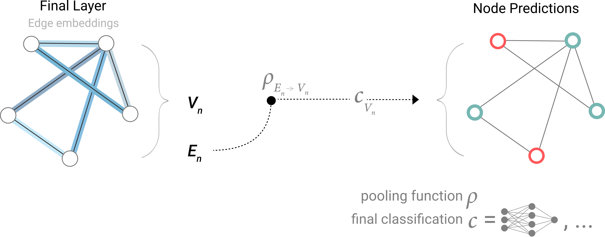{width=95%}

Si solo tenemos características a nivel de nodo y tratamos de predecir información binaria a nivel de arista, el modelo queda así.

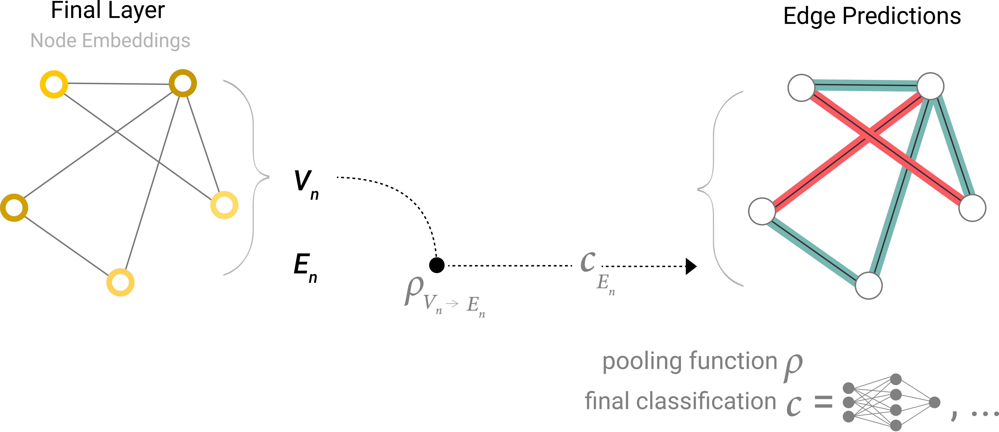{width=95%}

> **Nota al margen.** Un ejemplo de este escenario es la tarea de aristas que especificamos en la subsección «Tarea a nivel de arista». Los nodos pueden reconocerse como entidades de la imagen, y tratamos de predecir si las entidades comparten una relación (aristas binarias).

Si solo tenemos características a nivel de nodo y necesitamos predecir una propiedad global binaria, necesitamos reunir toda la información disponible de los nodos y agregarla. Esto es similar a las capas de *Global Average Pooling* de las CNN. Lo mismo puede hacerse con las aristas.

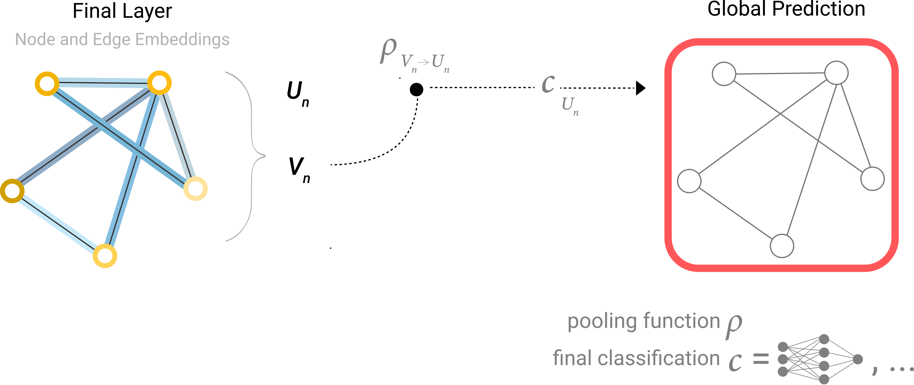{width=95%}

> **Nota al margen.** Este es un escenario común para predecir propiedades moleculares. Por ejemplo, tenemos información atómica y la conectividad, y nos gustaría saber la toxicidad de una molécula (tóxica/no tóxica), o si tiene un olor particular (rosa/no rosa).

En nuestros ejemplos, el modelo de clasificación $c$ puede sustituirse fácilmente por cualquier modelo diferenciable, o adaptarse a la clasificación multiclase usando un modelo lineal generalizado.

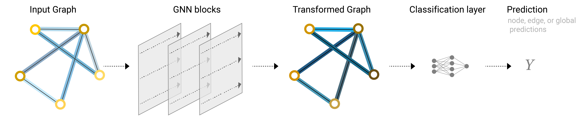{width=100%}

Ahora hemos demostrado que podemos construir un modelo de GNN sencillo y hacer predicciones binarias dirigiendo la información entre distintas partes del grafo. Esta técnica de agrupamiento servirá como bloque de construcción para modelos de GNN más sofisticados. Si tenemos nuevos atributos del grafo, solo tenemos que definir cómo pasar información de un atributo a otro.

Observe que en esta formulación de GNN más sencilla no estamos usando en absoluto la conectividad del grafo dentro de la capa de GNN. Cada nodo se procesa de forma independiente, al igual que cada arista y el contexto global. Solo usamos la conectividad al agrupar información para la predicción.

## Paso de mensajes entre las partes del grafo

Podríamos hacer predicciones más sofisticadas usando el agrupamiento dentro de la capa de GNN, para que nuestros *embeddings* aprendidos tengan en cuenta la conectividad del grafo. Podemos hacerlo usando el *paso de mensajes* (*message passing*) [18], en el que los nodos o aristas vecinos intercambian información e influyen en los *embeddings* actualizados de los demás.

El paso de mensajes funciona en tres pasos:

1\. Para cada nodo del grafo, se *reúnen* todos los *embeddings* (o *mensajes*) de los nodos vecinos, que es la función $g$ descrita arriba.

2\. Se agregan todos los mensajes mediante una función de agregación (como la suma).

3\. Todos los mensajes agrupados se pasan por una *función de actualización*, normalmente una red neuronal aprendida.

> **Nota al margen.** También podría 1) reunir los mensajes, 3) actualizarlos y 2) agregarlos, y seguiría teniendo una operación invariante a permutaciones [20].

Así como el agrupamiento puede aplicarse a nodos o a aristas, el paso de mensajes puede ocurrir entre nodos o entre aristas.

Estos pasos son clave para aprovechar la conectividad de los grafos. Construiremos variantes más elaboradas del paso de mensajes en las capas de GNN, que dan lugar a modelos de GNN cada vez más expresivos y poderosos.

**[Figura interactiva en el original]** *Pase el cursor sobre un nodo para resaltar los nodos adyacentes y visualizar el *embedding* adyacente que se agruparía, actualizaría y almacenaría.*

Esta secuencia de operaciones, aplicada una vez, es el tipo más sencillo de capa de GNN de paso de mensajes.

Esto recuerda a la convolución estándar: en esencia, el paso de mensajes y la convolución son operaciones para agregar y procesar la información de los vecinos de un elemento con el fin de actualizar el valor del elemento. En los grafos, el elemento es un nodo, y en las imágenes, el elemento es un píxel. Sin embargo, el número de nodos vecinos en un grafo puede ser variable, a diferencia de una imagen, donde cada píxel tiene un número fijo de elementos vecinos.

Al apilar capas de GNN de paso de mensajes, un nodo puede llegar a incorporar información de todo el grafo: después de tres capas, un nodo tiene información sobre los nodos que están a tres pasos de distancia.

Podemos actualizar nuestro diagrama de arquitectura para incluir esta nueva fuente de información para los nodos:

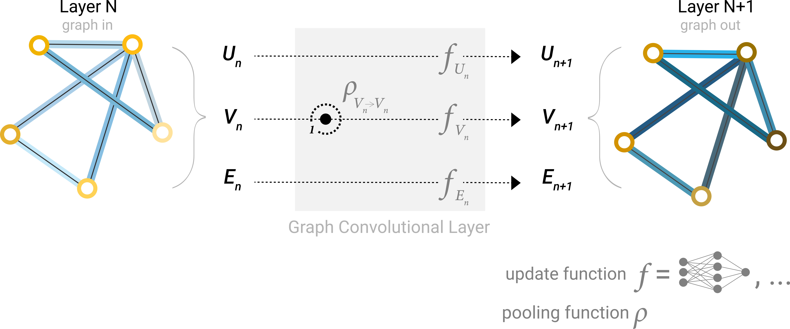{width=95%}

## Aprendizaje de representaciones de aristas

Nuestro conjunto de datos no siempre contiene todos los tipos de información (nodo, arista y contexto global). Cuando queremos hacer una predicción sobre los nodos, pero nuestro conjunto de datos solo tiene información de aristas, mostramos arriba cómo usar el agrupamiento para dirigir información de las aristas a los nodos, pero solo en el paso final de predicción del modelo. Podemos compartir información entre nodos y aristas dentro de la capa de GNN usando el paso de mensajes.

Podemos incorporar la información de las aristas vecinas de la misma forma en que usamos antes la información de los nodos vecinos: primero agrupando la información de las aristas, transformándola con una función de actualización y almacenándola.

Sin embargo, la información de nodos y de aristas almacenada en un grafo no tiene necesariamente el mismo tamaño o forma, así que no es inmediatamente claro cómo combinarlas. Una forma es aprender una transformación lineal del espacio de las aristas al espacio de los nodos, y viceversa. Alternativamente, se pueden concatenar antes de la función de actualización.

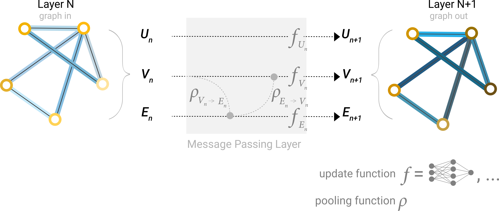{width=95%}

Qué atributos del grafo actualizamos y en qué orden los actualizamos es una decisión de diseño al construir GNN. Podríamos elegir si actualizar los *embeddings* de los nodos antes que los de las aristas, o al revés. Esta es un área abierta de investigación con una variedad de soluciones; por ejemplo, podríamos actualizar de forma «entretejida» (*weave*) [21], en la que tenemos cuatro representaciones actualizadas que se combinan en nuevas representaciones de nodos y aristas: de nodo a nodo (lineal), de arista a arista (lineal), de nodo a arista (capa de aristas) y de arista a nodo (capa de nodos).

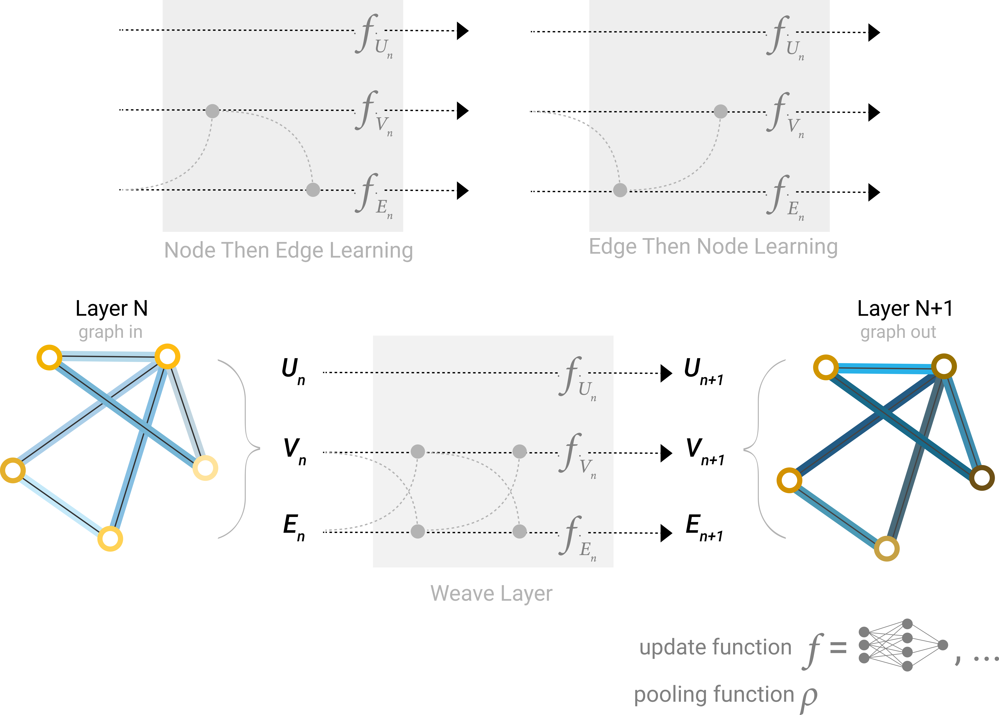{width=85%}

## Adición de representaciones globales

Hay un defecto en las redes que hemos descrito hasta ahora: los nodos que están lejos unos de otros en el grafo quizá nunca puedan transferirse información de forma eficiente, aunque apliquemos el paso de mensajes varias veces. Para un nodo, si tenemos $k$ capas, la información se propagará como máximo a $k$ pasos de distancia. Esto puede ser un problema en situaciones en las que la tarea de predicción depende de nodos, o grupos de nodos, que están muy separados. Una solución sería que todos los nodos pudieran pasarse información entre sí. Desafortunadamente, en grafos grandes esto se vuelve rápidamente costoso en cómputo (aunque este enfoque, llamado «aristas virtuales», se ha usado en grafos pequeños como las moléculas) [18].

Una solución a este problema es usar la representación global de un grafo (U), que a veces se llama *nodo maestro* [19] [18] o vector de contexto. Este vector de contexto global está conectado con todos los demás nodos y aristas de la red, y puede actuar como un puente entre ellos para pasar información, construyendo una representación del grafo como un todo. Esto crea una representación del grafo más rica y compleja de la que podría haberse aprendido de otro modo.

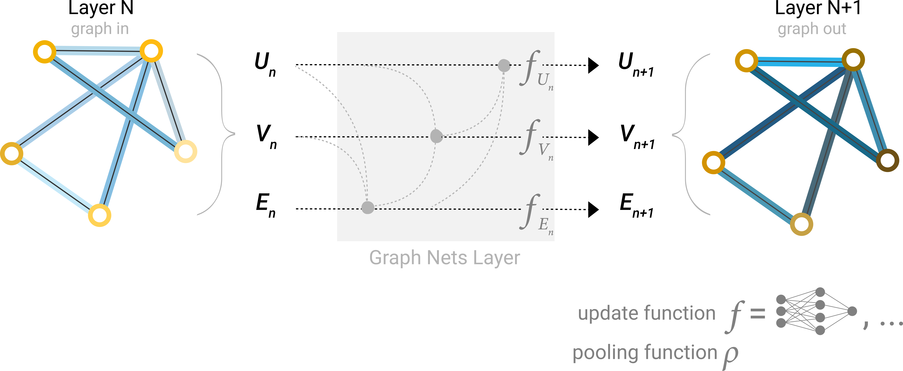{width=95%}

Desde este punto de vista, todos los atributos del grafo tienen representaciones aprendidas, así que podemos aprovecharlas durante el agrupamiento condicionando la información de nuestro atributo de interés con respecto al resto. Por ejemplo, para un nodo podemos considerar la información de los nodos vecinos, de las aristas conectadas y la información global. Para condicionar el nuevo *embedding* del nodo en todas estas posibles fuentes de información, podemos simplemente concatenarlas. Adicionalmente, también podemos llevarlas al mismo espacio mediante una transformación lineal y sumarlas, o aplicar una capa de modulación por características (*feature-wise modulation*) [22], que puede considerarse un tipo de mecanismo de atención por características.

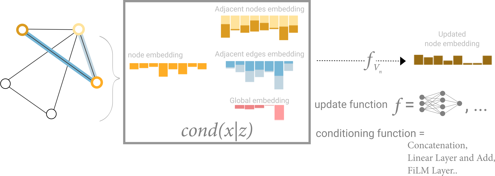{width=95%}

# Zona de juego de GNN (*GNN playground*)

Hemos descrito una amplia gama de componentes de GNN, pero ¿cómo se diferencian realmente en la práctica? Esta zona de juego de GNN le permite ver cómo estos distintos componentes y arquitecturas contribuyen a la capacidad de una GNN de aprender una tarea real.

Nuestra zona de juego muestra una tarea de predicción a nivel de grafo con grafos moleculares pequeños. Usamos el conjunto de datos de olores de Leffingwell (*Leffingwell Odor Dataset*) [23] [24], que está compuesto por moléculas con percepciones de olor asociadas (etiquetas). Predecir la relación entre una estructura molecular (grafo) y su olor es un problema de hace 100 años que abarca la química, la física, la neurociencia y el aprendizaje automático.

Para simplificar el problema, consideramos solo una etiqueta binaria por molécula, clasificando si un grafo molecular huele «penetrante» (*pungent*) o no, según la etiqueta de un perfumista profesional. Decimos que una molécula tiene un aroma «penetrante» si tiene un olor fuerte y llamativo. Por ejemplo, el ajo y la mostaza, que podrían contener la molécula alcohol alílico, tienen esta cualidad. La molécula piperitona, usada a menudo en dulces con sabor a menta, también se describe como de olor penetrante.

Representamos cada molécula como un grafo, en el que los átomos son nodos que contienen una codificación *one-hot* de su identidad atómica (carbono, nitrógeno, oxígeno, flúor) y los enlaces son aristas que contienen una codificación *one-hot* de su tipo de enlace (simple, doble, triple o aromático).

Nuestra plantilla general de modelado para este problema se construirá con capas de GNN secuenciales, seguidas de un modelo lineal con una activación sigmoide para la clasificación. El espacio de diseño de nuestra GNN tiene muchas palancas que pueden personalizar el modelo:

1\. El número de capas de GNN, también llamado *profundidad*.

2\. La dimensionalidad de cada atributo al actualizarse. La función de actualización es un MLP de 1 capa con una función de activación ReLU y una normalización de capa (*layer norm*) para normalizar las activaciones.

3\. La función de agregación usada en el agrupamiento: máximo, media o suma.

4\. Los atributos del grafo que se actualizan, o estilos de paso de mensajes: nodos, aristas y representación global. Los controlamos mediante interruptores booleanos (encendido o apagado). Un modelo de referencia sería una GNN independiente del grafo (todo el paso de mensajes apagado), que agrega todos los datos al final en un solo atributo global. Encender todas las funciones de paso de mensajes da lugar a una arquitectura GraphNets.

Para entender mejor cómo una GNN aprende una representación de un grafo optimizada para la tarea, también observamos las activaciones de la penúltima capa de la GNN. Estos «*embeddings* del grafo» son las salidas del modelo de GNN justo antes de la predicción. Como usamos un modelo lineal generalizado para la predicción, una transformación lineal basta para permitirnos ver cómo estamos aprendiendo representaciones alrededor de la frontera de decisión.

Como estos son vectores de alta dimensión, los reducimos a 2D mediante análisis de componentes principales (PCA). Un modelo perfecto separaría visiblemente los datos etiquetados, pero como estamos reduciendo la dimensionalidad y además tenemos modelos imperfectos, esta frontera podría ser más difícil de ver.

Experimente con distintas arquitecturas de modelo para formarse una intuición. Por ejemplo, vea si puede editar la molécula de la izquierda para hacer que la predicción del modelo aumente. ¿Las mismas ediciones tienen los mismos efectos en distintas arquitecturas de modelo?

> **Nota al margen.** Esta zona de juego se ejecuta en vivo en el navegador con tfjs.

**[Figura interactiva en el original]** *Edite la molécula para ver cómo cambia la predicción, o cambie los parámetros del modelo para cargar un modelo diferente. Seleccione una molécula distinta en el diagrama de dispersión.*

## Algunas lecciones empíricas de diseño de GNN

Al explorar las opciones de arquitectura anteriores, quizá haya encontrado que algunos modelos tienen mejor desempeño que otros. ¿Hay algunas decisiones claras de diseño de GNN que nos den un mejor desempeño? Por ejemplo, ¿los modelos de GNN más profundos funcionan mejor que los menos profundos? ¿O hay una elección clara entre las funciones de agregación? Las respuestas van a depender de los datos [25] [26], e incluso distintas formas de caracterizar y construir los grafos pueden dar respuestas diferentes.

Con la siguiente figura interactiva, exploramos el espacio de arquitecturas de GNN y el desempeño en esta tarea a lo largo de algunas decisiones de diseño principales: estilo de paso de mensajes, dimensionalidad de los *embeddings*, número de capas y tipo de operación de agregación.

Cada punto del diagrama de dispersión representa un modelo: el eje x es el número de variables entrenables y el eje y es el desempeño. Pase el cursor sobre un punto para ver los parámetros de la arquitectura de GNN.

**[Figura interactiva en el original]** *Diagrama de dispersión del desempeño de cada modelo frente a su número de variables entrenables. Pase el cursor sobre un punto para ver los parámetros de la arquitectura de GNN.*

Lo primero que hay que notar es que, sorprendentemente, un mayor número de parámetros sí se correlaciona con un mayor desempeño. Las GNN son un tipo de modelo muy eficiente en parámetros: incluso con un número pequeño de parámetros (3k) ya podemos encontrar modelos con alto desempeño.

A continuación, podemos ver las distribuciones del desempeño agregadas según la dimensionalidad de las representaciones aprendidas para los distintos atributos del grafo.

**[Figura interactiva en el original]** *Desempeño agregado de los modelos según las distintas dimensiones de nodos, aristas y global.*

Podemos notar que los modelos con mayor dimensionalidad tienden a tener mejor desempeño medio y mejor cota inferior, pero la misma tendencia no se encuentra en el máximo. Algunos de los modelos de mejor desempeño se encuentran con dimensiones más pequeñas. Como una mayor dimensionalidad también implicará un mayor número de parámetros, estas observaciones van de la mano con la figura anterior.

Después podemos ver el desglose del desempeño según el número de capas de GNN.

**[Figura interactiva en el original]** *Gráfica del número de capas frente al desempeño del modelo, y diagrama de dispersión del desempeño del modelo frente al número de parámetros. Cada punto está coloreado según el número de capas. Pase el cursor sobre un punto para ver los parámetros de la arquitectura de GNN.*

El diagrama de caja muestra una tendencia similar: aunque el desempeño medio tiende a aumentar con el número de capas, los modelos de mejor desempeño no tienen tres o cuatro capas, sino dos. Además, la cota inferior del desempeño disminuye con cuatro capas. Este efecto se ha observado antes: una GNN con un mayor número de capas difundirá información a una distancia mayor y puede correr el riesgo de que sus representaciones de nodos se «diluyan» tras muchas iteraciones sucesivas [27].

¿Nuestro conjunto de datos tiene una operación de agregación preferida? Nuestra siguiente figura desglosa el desempeño según el tipo de agregación.

**[Figura interactiva en el original]** *Gráfica del tipo de agregación frente al desempeño del modelo, y diagrama de dispersión del desempeño del modelo frente al número de parámetros. Cada punto está coloreado según el tipo de agregación. Pase el cursor sobre un punto para ver los parámetros de la arquitectura de GNN.*

En general, parece que la suma tiene una mejora muy ligera en el desempeño medio, pero el máximo o la media pueden dar modelos igual de buenos. Es útil tener esto en cuenta al considerar las capacidades discriminativas o expresivas de las operaciones de agregación.

Las exploraciones anteriores han dado mensajes mixtos. Podemos encontrar tendencias medias en las que más complejidad da mejor desempeño, pero también contraejemplos claros en los que modelos con menos parámetros, menos capas o menor dimensionalidad funcionan mejor. Una tendencia mucho más clara tiene que ver con el número de atributos que se pasan información entre sí.

Aquí desglosamos el desempeño según el estilo de paso de mensajes. En ambos extremos, consideramos modelos que no se comunican entre las entidades del grafo («ninguno») y modelos que tienen paso de mensajes entre nodos, aristas y globales.

**[Figura interactiva en el original]** *Gráfica del paso de mensajes frente al desempeño del modelo, y diagrama de dispersión del desempeño del modelo frente al número de parámetros. Cada punto está coloreado según el paso de mensajes. Pase el cursor sobre un punto para ver los parámetros de la arquitectura de GNN.*

En general, vemos que cuantos más atributos del grafo se comunican, mejor es el desempeño del modelo promedio. Nuestra tarea está centrada en las representaciones globales, así que aprender explícitamente este atributo también tiende a mejorar el desempeño. Nuestras representaciones de nodos también parecen ser más útiles que las representaciones de aristas, lo cual tiene sentido, ya que en estos atributos se carga más información.

Hay muchas direcciones que podría tomar a partir de aquí para obtener un mejor desempeño. Queremos destacar dos direcciones generales, una relacionada con algoritmos de grafos más sofisticados y otra con el grafo en sí.

Hasta ahora, nuestra GNN se basa en una operación de agrupamiento basada en vecindades. Hay algunos conceptos de grafos que son más difíciles de expresar de esta manera, por ejemplo una trayectoria lineal en un grafo (una cadena conectada de nodos). Diseñar nuevos mecanismos con los que la información del grafo pueda extraerse, ejecutarse y propagarse en una GNN es un área de investigación actual [28], [29], [30], [31].

Una de las fronteras de la investigación en GNN no es crear nuevos modelos y arquitecturas, sino «cómo construir los grafos»; para ser más precisos, dotar a los grafos de estructura o relaciones adicionales que puedan aprovecharse. Como vimos a grandes rasgos, cuantos más atributos del grafo se comunican, más tendemos a tener mejores modelos. En este caso particular, podríamos considerar hacer los grafos moleculares más ricos en características, añadiendo relaciones espaciales adicionales entre los nodos, añadiendo aristas que no son enlaces, o relaciones explícitas aprendibles entre subgrafos.

> **Nota al margen.** Vea más en «Otros tipos de grafos».

# Entrando en detalle (*Into the Weeds*)

A continuación tenemos algunas secciones sobre una gran variedad de temas relacionados con los grafos que son relevantes para las GNN.

## Otros tipos de grafos (multigrafos, hipergrafos, hipernodos, grafos jerárquicos)

Aunque solo describimos grafos con información vectorizada para cada atributo, las estructuras de grafo son más flexibles y pueden acomodar otros tipos de información. Afortunadamente, el marco de paso de mensajes es lo bastante flexible como para que, a menudo, adaptar las GNN a estructuras de grafo más complejas consista en definir cómo se pasa y se actualiza la información con los nuevos atributos del grafo.

Por ejemplo, podemos considerar grafos con múltiples aristas o *multigrafos* [32], en los que un par de nodos puede compartir varios tipos de aristas; esto ocurre cuando queremos modelar las interacciones entre nodos de forma diferente según su tipo. Por ejemplo, en una red social podemos especificar tipos de aristas según el tipo de relación (conocido, amigo, familia). Una GNN puede adaptarse con distintos tipos de pasos de paso de mensajes para cada tipo de arista. También podemos considerar grafos anidados, en los que, por ejemplo, un nodo representa un grafo; también se llaman grafos de hipernodos [33]. Los grafos anidados son útiles para representar información jerárquica. Por ejemplo, podemos considerar una red de moléculas, en la que un nodo representa una molécula y dos moléculas comparten una arista si tenemos una forma (reacción) de transformar una en la otra [34] [35]. En este caso, podemos aprender sobre un grafo anidado con una GNN que aprende representaciones a nivel de molécula y otra a nivel de la red de reacciones, alternando entre ellas durante el entrenamiento.

Otro tipo de grafo es el *hipergrafo* [36], en el que una arista puede conectarse a varios nodos en lugar de solo a dos. Para un grafo dado, podemos construir un hipergrafo identificando comunidades de nodos y asignando una hiperarista conectada a todos los nodos de una comunidad.

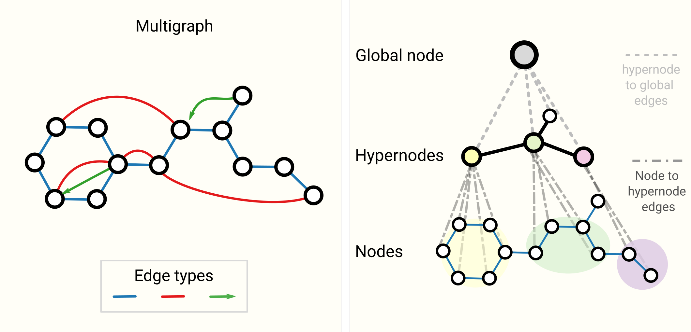{width=75%}

Cómo entrenar y diseñar GNN que tengan varios tipos de atributos del grafo es un área de investigación actual [37], [38].

## Muestreo de grafos y procesamiento por lotes en GNN

Una práctica común para entrenar redes neuronales es actualizar los parámetros de la red con gradientes calculados sobre subconjuntos aleatorios de tamaño constante (tamaño de lote) de los datos de entrenamiento (minilotes). Esta práctica presenta un reto para los grafos debido a la variabilidad en el número de nodos y aristas adyacentes entre sí, lo que significa que no podemos tener un tamaño de lote constante. La idea principal del procesamiento por lotes con grafos es crear subgrafos que preserven las propiedades esenciales del grafo más grande. Esta operación de muestreo de grafos depende mucho del contexto e implica subseleccionar nodos y aristas de un grafo. Estas operaciones pueden tener sentido en algunos contextos (redes de citas) y en otros pueden ser una operación demasiado fuerte (moléculas, donde un subgrafo simplemente representa una molécula nueva y más pequeña). Cómo muestrear un grafo es una pregunta de investigación abierta [39]. Si nos interesa preservar la estructura a nivel de vecindad, una forma sería muestrear al azar un número uniforme de nodos, nuestro *conjunto de nodos*. Después, se añaden los nodos vecinos a distancia $k$ del conjunto de nodos, incluidas sus aristas [40]. Cada vecindad puede considerarse un grafo individual, y una GNN puede entrenarse con lotes de estos subgrafos. La pérdida puede enmascararse para considerar solo el conjunto de nodos, ya que todos los nodos vecinos tendrían vecindades incompletas. Una estrategia más eficiente podría ser muestrear primero al azar un solo nodo, expandir su vecindad hasta la distancia $k$ y luego elegir el otro nodo dentro del conjunto expandido. Estas operaciones pueden terminarse una vez que se ha construido cierta cantidad de nodos, aristas o subgrafos. Si el contexto lo permite, podemos construir vecindades de tamaño constante eligiendo un conjunto inicial de nodos y luego submuestreando un número constante de nodos (por ejemplo, al azar, o mediante una caminata aleatoria o el algoritmo de Metropolis [41]).

{width=65%}

Muestrear un grafo es particularmente relevante cuando un grafo es lo bastante grande como para no caber en memoria, lo que ha inspirado nuevas arquitecturas y estrategias de entrenamiento como Cluster-GCN [42] y GraphSaint [43]. Esperamos que los conjuntos de datos de grafos sigan creciendo en tamaño en el futuro.

## Sesgos inductivos

Al construir un modelo para resolver un problema sobre un tipo específico de datos, queremos especializar nuestros modelos para aprovechar las características de esos datos. Cuando esto se hace con éxito, a menudo vemos un mejor desempeño predictivo, un menor tiempo de entrenamiento, menos parámetros y una mejor generalización.

Al etiquetar imágenes, por ejemplo, queremos aprovechar el hecho de que un perro sigue siendo un perro tanto si está en la esquina superior izquierda como en la inferior derecha de una imagen. Por ello, la mayoría de los modelos de imágenes usan convoluciones, que son invariantes a traslaciones. Para el texto, el orden de los *tokens* es muy importante, así que las redes neuronales recurrentes procesan los datos de forma secuencial. Además, la presencia de un *token* (por ejemplo, la palabra «no») puede afectar el significado del resto de una oración, por lo que necesitamos componentes que puedan «atender» a otras partes del texto, lo cual pueden hacer los modelos *transformer* como BERT y GPT-3. Estos son algunos ejemplos de sesgos inductivos, en los que identificamos simetrías o regularidades en los datos y añadimos componentes de modelado que aprovechan estas propiedades.

En el caso de los grafos, nos interesa cómo se relaciona cada componente del grafo (arista, nodo, global) con los demás, así que buscamos modelos que tengan un sesgo inductivo relacional [19]. Un modelo debe preservar las relaciones explícitas entre entidades (la matriz de adyacencia) y preservar las simetrías del grafo (la invariancia a permutaciones). Esperamos que los problemas en los que la interacción entre entidades es importante se beneficien de una estructura de grafo. En concreto, esto significa diseñar transformaciones sobre conjuntos: el orden de las operaciones sobre los nodos o las aristas no debe importar y la operación debe funcionar con un número variable de entradas.

## Comparación de operaciones de agregación

Agrupar información de los nodos y aristas vecinos es un paso crítico en cualquier arquitectura de GNN razonablemente poderosa. Como cada nodo tiene un número variable de vecinos, y como queremos un método diferenciable para agregar esta información, queremos usar una operación de agregación suave que sea invariante al orden de los nodos y al número de nodos proporcionados.

Seleccionar y diseñar operaciones de agregación óptimas es un tema de investigación abierto [44]. Una propiedad deseable de una operación de agregación es que entradas similares produzcan salidas agregadas similares, y viceversa. Algunas operaciones candidatas muy sencillas e invariantes a permutaciones son la suma, la media y el máximo. Las estadísticas resumidas como la varianza también funcionan. Todas ellas toman un número variable de entradas y producen una salida que es la misma sin importar el orden de las entradas. Exploremos la diferencia entre estas operaciones.

**[Figura interactiva en el original]** *Ningún tipo de agrupamiento puede distinguir siempre entre pares de grafos, como el agrupamiento por máximo a la izquierda y el agrupamiento por suma o media a la derecha.*

No hay una operación que sea uniformemente la mejor opción. La operación de media puede ser útil cuando los nodos tienen un número muy variable de vecinos o cuando se necesita una vista normalizada de las características de una vecindad local. La operación de máximo puede ser útil cuando se quiere resaltar características individuales destacadas en las vecindades locales. La suma ofrece un equilibrio entre ambas, al proporcionar una instantánea de la distribución local de las características, pero, como no está normalizada, también puede resaltar valores atípicos. En la práctica, la suma es la que se usa con más frecuencia.

Diseñar operaciones de agregación es un problema de investigación abierto que se cruza con el aprendizaje automático sobre conjuntos [45]. Enfoques nuevos como la agregación de vecindad principal (*Principal Neighborhood Aggregation*) [27] toman en cuenta varias operaciones de agregación concatenándolas y añadiendo una función de escalamiento que depende del grado de conectividad de la entidad que se agrega. Mientras tanto, también pueden diseñarse operaciones de agregación específicas del dominio. Un ejemplo son los operadores de agregación de «quiralidad tetraédrica» [46].

## La GCN como aproximador de funciones sobre subgrafos

Otra forma de ver una GCN (y una MPNN) de $k$ capas con una búsqueda de vecinos de grado 1 es como una red neuronal que opera sobre *embeddings* aprendidos de subgrafos de tamaño $k$ [47] [44].

Al centrarnos en un nodo, después de $k$ capas, la representación actualizada del nodo tiene una visión limitada de todos los vecinos hasta la distancia $k$, que es esencialmente una representación de un subgrafo. Lo mismo ocurre con las representaciones de las aristas.

Así, una GCN recolecta todos los subgrafos posibles de tamaño $k$ y aprende representaciones vectoriales desde el punto de vista de un nodo o de una arista. El número de subgrafos posibles puede crecer de forma combinatoria, así que enumerar estos subgrafos desde el principio, en lugar de construirlos dinámicamente como en una GCN, podría ser prohibitivo.

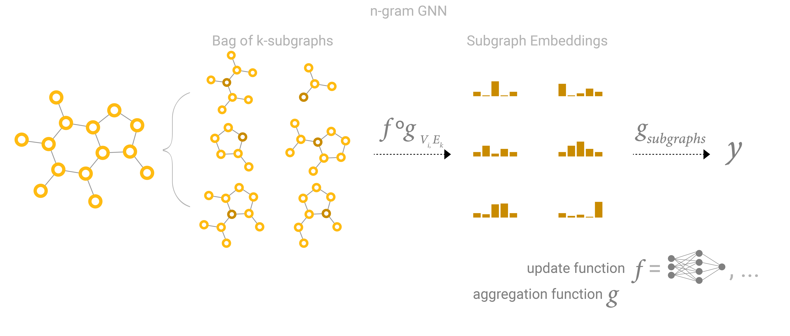{width=95%}

## Las aristas y el grafo dual

Algo que hay que notar es que las predicciones sobre aristas y las predicciones sobre nodos, aunque parezcan distintas, a menudo se reducen al mismo problema: una tarea de predicción de aristas sobre un grafo $G$ puede formularse como una predicción a nivel de nodo sobre el dual de $G$.

Para obtener el dual de $G$, podemos convertir los nodos en aristas (y las aristas en nodos). Un grafo y su dual contienen la misma información, solo que expresada de forma diferente. A veces esta propiedad hace que resolver problemas sea más fácil en una representación que en otra, como las frecuencias en el espacio de Fourier. En resumen, para resolver un problema de clasificación de aristas en $G$, podemos pensar en hacer convoluciones de grafo sobre el dual de $G$ (que es lo mismo que aprender representaciones de aristas en $G$); esta idea se desarrolló con las redes convolucionales de grafos dual-primal (*Dual-Primal Graph Convolutional Networks*) [48].

## Las convoluciones de grafo como multiplicaciones de matrices, y las multiplicaciones de matrices como caminatas sobre un grafo

Hemos hablado mucho de convoluciones de grafo y de paso de mensajes y, por supuesto, esto plantea la pregunta de cómo implementar estas operaciones en la práctica. En esta sección exploramos algunas propiedades de la multiplicación de matrices, del paso de mensajes y de su conexión con el recorrido de un grafo.

El primer punto que queremos ilustrar es que la multiplicación de una matriz de adyacencia $A$ de $n_{nodes} \times n_{nodes}$ por una matriz de características de nodos $X$ de tamaño $n_{nodes} \times node_{dim}$ implementa un paso de mensajes sencillo con agregación por suma. Sea la matriz $B=AX$; podemos observar que cualquier entrada $B_{ij}$ puede expresarse como $\langle A_{row_i}, X_{column_j}\rangle = A_{i,1}X_{1,j}+A_{i,2}X_{2,j}+\dots+A_{i,n}X_{n,j}=\sum_{A_{i,k}>0} X_{k,j}$.^[*Nota del traductor:* en el original esta fórmula se escribe $<A_{row_i} \dot X_{column_j}>$; se normalizó la notación del producto interno.] Como las $A_{i,k}$ son entradas binarias, distintas de cero solo cuando existe una arista entre $node_i$ y $node_k$, el producto interno esencialmente «reúne» todos los valores de las características de nodo de la dimensión $j$ de los nodos que comparten una arista con $node_i$. Hay que señalar que este paso de mensajes no está actualizando la representación de las características de los nodos, solo agrupando las características de los nodos vecinos. Pero esto puede adaptarse fácilmente pasando $X$ por su transformación diferenciable favorita (por ejemplo, un MLP) antes o después de la multiplicación de matrices.

Desde este punto de vista, podemos apreciar el beneficio de usar listas de adyacencia. Debido a la dispersión esperada de $A$, no tenemos que sumar todos los valores en los que $A_{i,j}$ es cero. Mientras tengamos una operación para reunir valores con base en un índice, deberíamos poder recuperar solo las entradas positivas. Además, este enfoque sin multiplicación de matrices nos libera de usar la suma como operación de agregación.

Podemos imaginar que aplicar esta operación varias veces nos permite propagar información a mayores distancias. En este sentido, la multiplicación de matrices es una forma de recorrer un grafo. Esta relación también es evidente cuando observamos las potencias $A^K$ de la matriz de adyacencia. Si consideramos la matriz $A^2$, el término $A^2_{ij}$ cuenta todas las caminatas de longitud 2 desde $node_{i}$ hasta $node_{j}$ y puede expresarse como el producto interno $\langle A_{row_i}, A_{column_j}\rangle = A_{i,1}A_{1,j}+A_{i,2}A_{2,j}+\dots+A_{i,n}A_{n,j}$.^[*Nota del traductor:* el original escribe el último término como $A{n,j}$; se corrigió a $A_{n,j}$.] La intuición es que el primer término $a_{i,1}a_{1,j}$ solo es positivo bajo dos condiciones: que haya una arista que conecte $node_i$ con $node_1$ y otra arista que conecte $node_{1}$ con $node_{j}$. En otras palabras, ambas aristas forman una trayectoria de longitud 2 que va de $node_i$ a $node_j$ pasando por $node_1$. Debido a la suma, estamos contando sobre todos los nodos intermedios posibles. Esta intuición se mantiene cuando consideramos $A^3 = A\,A^2$,^[*Nota del traductor:* el original escribe «$A^3=A \backslash\mathrm{matrix}\,A^2$», con un comando de LaTeX sobrante; se entiende el producto matricial $A\,A^2$.] y así sucesivamente hasta $A^k$.

Hay conexiones más profundas sobre cómo podemos ver las matrices como grafos que vale la pena explorar [49] [50] [51].

## Redes de atención sobre grafos (*Graph Attention Networks*)

Otra forma de comunicar información entre los atributos del grafo es mediante la atención [52]. Por ejemplo, cuando consideramos la agregación por suma de un nodo y sus nodos vecinos de grado 1, también podríamos considerar usar una suma ponderada. El reto entonces es asociar los pesos de forma invariante a permutaciones. Un enfoque es considerar una función de puntuación escalar que asigne pesos con base en pares de nodos ($f(node_i, node_j)$). En este caso, la función de puntuación puede interpretarse como una función que mide qué tan relevante es un nodo vecino en relación con el nodo central. Los pesos pueden normalizarse, por ejemplo con una función softmax, para concentrar la mayor parte del peso en el vecino más relevante para un nodo en relación con una tarea. Este concepto es la base de las redes de atención sobre grafos (GAT) [53] y de los *Set Transformers* [54]. La invariancia a permutaciones se preserva, porque la puntuación trabaja sobre pares de nodos. Una función de puntuación común es el producto interno, y a menudo los nodos se transforman antes de la puntuación en vectores de consulta (*query*) y clave (*key*) mediante una transformación lineal, para aumentar la expresividad del mecanismo de puntuación. Además, para la interpretabilidad, los pesos de la puntuación pueden usarse como una medida de la importancia de una arista en relación con una tarea.

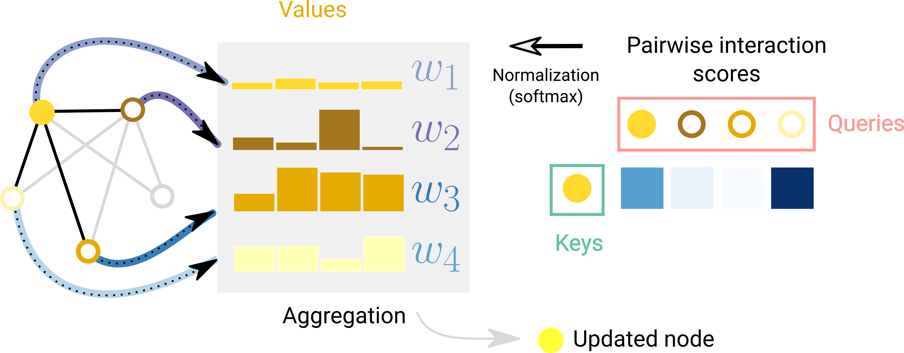{width=80%}

Además, los *transformers* pueden verse como GNN con un mecanismo de atención [55]. Desde este punto de vista, el *transformer* modela varios elementos (por ejemplo, *tokens* de caracteres) como nodos de un grafo completamente conectado, y el mecanismo de atención asigna *embeddings* de arista a cada par de nodos, que se usan para calcular los pesos de atención. La diferencia está en el patrón de conectividad que se supone entre las entidades: una GNN supone un patrón disperso y el *transformer* modela todas las conexiones.

## Explicaciones y atribuciones en grafos

Al desplegar GNN en el mundo real, puede interesarnos la interpretabilidad del modelo para generar credibilidad, depurar o hacer descubrimientos científicos. Los conceptos de grafo que nos interesa explicar varían de un contexto a otro. Por ejemplo, con moléculas podría interesarnos la presencia o ausencia de subgrafos particulares [56], mientras que en una red de citas podría interesarnos el grado de conectividad de un artículo. Debido a la variedad de conceptos de grafo, hay muchas formas de construir explicaciones. GNNExplainer [57] plantea este problema como la extracción del subgrafo más relevante que es importante para una tarea. Las técnicas de atribución [58] asignan valores de importancia ordenados a las partes de un grafo que son relevantes para una tarea. Como pueden generarse sintéticamente problemas de grafos realistas y desafiantes, las GNN pueden servir como un banco de pruebas riguroso y repetible para evaluar técnicas de atribución [59].

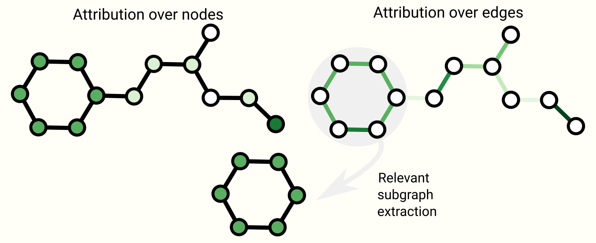{width=75%}

## Modelado generativo

Además de aprender modelos predictivos sobre grafos, podría interesarnos aprender un modelo generativo de grafos. Con un modelo generativo podemos generar grafos nuevos muestreando de una distribución aprendida, o completando un grafo dado un punto de partida. Una aplicación relevante es el diseño de nuevos fármacos, en el que se buscan grafos moleculares novedosos con propiedades específicas como candidatos para tratar una enfermedad.

Un reto clave de los modelos generativos de grafos está en modelar la topología de un grafo, que puede variar drásticamente en tamaño y tiene $N_{nodes}^2$ términos. Una solución está en modelar directamente la matriz de adyacencia como una imagen, con un marco de autocodificador [60]. La predicción de la presencia o ausencia de una arista se trata como una tarea de clasificación binaria. El término $N_{nodes}^2$ puede evitarse prediciendo solo las aristas conocidas y un subconjunto de las aristas que no están presentes. El graphVAE aprende a modelar patrones positivos de conectividad y algunos patrones de no conectividad en la matriz de adyacencia.

Otro enfoque es construir un grafo de forma secuencial, comenzando con un grafo y aplicando iterativamente acciones discretas como la adición o eliminación de nodos y aristas. Para evitar estimar un gradiente para acciones discretas, podemos usar un gradiente de política (*policy gradient*). Esto se ha hecho mediante un modelo autorregresivo, como una RNN [61], o en un escenario de aprendizaje por refuerzo [62]. Además, a veces los grafos pueden modelarse simplemente como secuencias con elementos de una gramática [63] [64].

# Reflexiones finales

Los grafos son un tipo de datos estructurados, poderoso y rico, que tiene fortalezas y retos muy distintos de los de las imágenes y el texto. En este artículo hemos esbozado algunos de los hitos que los investigadores han alcanzado al construir modelos basados en redes neuronales que procesan grafos. Hemos recorrido algunas de las decisiones de diseño importantes que deben tomarse al usar estas arquitecturas y, ojalá, la zona de juego de GNN pueda dar una intuición de cuáles son los resultados empíricos de estas decisiones de diseño. El éxito de las GNN en los últimos años crea una gran oportunidad para una amplia gama de problemas nuevos, y nos entusiasma ver lo que traerá el área.

# Referencias

Lista en el orden en que se citan en el texto, tomada de la bibliografía del original (títulos en su idioma original).

```{=latex}
{\small
```

[1] Daigavane, Ameya; Ravindran, Balaraman; Aggarwal, Gaurav (2021). Understanding Convolutions on Graphs. *Distill*.

[2] Scarselli, F et al. (2009). The Graph Neural Network Model. *IEEE Transactions on Neural Networks*.

[3] Stokes, Jonathan M et al. (2020). A Deep Learning Approach to Antibiotic Discovery. *Cell*.

[4] Sanchez-Gonzalez, Alvaro et al. (2020). Learning to simulate complex physics with graph networks.

[5] Monti, Federico et al. (2019). Fake News Detection on Social Media using Geometric Deep Learning.

[6] *, Oliver Lange; Perez, Luis. Traffic prediction with advanced Graph Neural Networks.

[7] Eksombatchai, Chantat et al. (2017). Pixie: A System for Recommending 3+ Billion Items to 200+ Million Users in Real-Time.

[8] Duvenaud, David et al. (2015). Convolutional Networks on Graphs for Learning Molecular Fingerprints.

[9] Mikolov, Tomas et al. (2013). Distributed Representations of Words and Phrases and their Compositionality.

[10] Devlin, Jacob et al. (2018). BERT: Pre-training of Deep Bidirectional Transformers for Language Understanding.

[11] Pennington, Jeffrey; Socher, Richard; Manning, Christopher (2014). Glove: Global Vectors for Word Representation. *Proceedings of the 2014 Conference on Empirical Methods in Natural Language Processing (EMNLP)*.

[12] Allamanis, Miltiadis; Brockschmidt, Marc; Khademi, Mahmoud (2017). Learning to Represent Programs with Graphs.

[13] Lample, Guillaume; Charton, Francois (2019). Deep Learning for Symbolic Mathematics.

[14] Kunegis, Jerome (2013). KONECT. *Proceedings of the 22nd International Conference on World Wide Web - WWW '13 Companion*.

[15] Zachary, Wayne W (1977). An Information Flow Model for Conflict and Fission in Small Groups. *J. Anthropol. Res.*.

[16] Mena, Gonzalo et al. (2018). Learning Latent Permutations with Gumbel-Sinkhorn Networks.

[17] Murphy, Ryan L et al. (2018). Janossy Pooling: Learning Deep Permutation-Invariant Functions for Variable-Size Inputs.

[18] Gilmer, Justin et al. (2017). Neural Message Passing for Quantum Chemistry. *Proceedings of the 34th International Conference on Machine Learning*.

[19] Battaglia, Peter W et al. (2018). Relational inductive biases, deep learning, and graph networks.

[20] Zaheer, Manzil et al. (2017). Deep Sets.

[21] Kearnes, Steven et al. (2016). Molecular graph convolutions: moving beyond fingerprints. *J. Comput. Aided Mol. Des.*.

[22] Dumoulin, Vincent et al. (2018). Feature-wise transformations. *Distill*.

[23] Sanchez-Lengeling, Benjamin et al. (2020). Leffingwell Odor Dataset.

[24] Sanchez-Lengeling, Benjamin et al. (2019). Machine Learning for Scent: Learning Generalizable Perceptual Representations of Small Molecules.

[25] Dwivedi, Vijay Prakash et al. (2020). Benchmarking Graph Neural Networks.

[26] You, Jiaxuan; Ying, Rex; Leskovec, Jure (2020). Design Space for Graph Neural Networks.

[27] Corso, Gabriele et al. (2020). Principal Neighbourhood Aggregation for Graph Nets.

[28] Markowitz, Elan et al. (2021). Graph Traversal with Tensor Functionals: A Meta-Algorithm for Scalable Learning.

[29] Du, Simon S et al. (2019). Graph Neural Tangent Kernel: Fusing Graph Neural Networks with Graph Kernels.

[30] Xu, Keyulu et al. (2018). Representation Learning on Graphs with Jumping Knowledge Networks.

[31] Velickovic, Petar et al. (2019). Neural Execution of Graph Algorithms.

[32] Harary, Frank (1969). Graph Theory.

[33] Poulovassilis, Alexandra; Levene, Mark (1994). A nested-graph model for the representation and manipulation of complex objects. *ACM Transactions on Information Systems*.

[34] Zitnik, Marinka; Agrawal, Monica; Leskovec, Jure (2018). Modeling polypharmacy side effects with graph convolutional networks. *Bioinformatics*.

[35] Stocker, Sina et al. (2020). Machine learning in chemical reaction space. *Nat. Commun.*.

[36] Berge, Claude (1976). Graphs and Hypergraphs. *Elsevier*.

[37] Yadati, Naganand et al. (2018). HyperGCN: A New Method of Training Graph Convolutional Networks on Hypergraphs.

[38] Zhong, Zhiqiang; Li, Cheng-Te; Pang, Jun (2020). Hierarchical Message-Passing Graph Neural Networks.

[39] Rozemberczki, Benedek; Kiss, Oliver; Sarkar, Rik (2020). Little Ball of Fur. *Proceedings of the 29th ACM International Conference on Information & Knowledge Management*.

[40] Leskovec, Jure; Faloutsos, Christos (2006). Sampling from large graphs. *Proceedings of the 12th ACM SIGKDD international conference on Knowledge discovery and data mining - KDD '06*.

[41] Hubler, Christian et al. (2008). Metropolis Algorithms for Representative Subgraph Sampling. *2008 Eighth IEEE International Conference on Data Mining*.

[42] Chiang, Wei-Lin et al. (2019). Cluster-GCN: An Efficient Algorithm for Training Deep and Large Graph Convolutional Networks.

[43] Zeng, Hanqing et al. (2019). GraphSAINT: Graph Sampling Based Inductive Learning Method.

[44] Xu, Keyulu et al. (2018). How Powerful are Graph Neural Networks?.

[45] Skianis, Konstantinos et al. (2019). Rep the Set: Neural Networks for Learning Set Representations.

[46] Pattanaik, Lagnajit et al. (2020). Message Passing Networks for Molecules with Tetrahedral Chirality.

[47] Liu, Shengchao; Demirel, Mehmet Furkan; Liang, Yingyu (2018). N-Gram Graph: Simple Unsupervised Representation for Graphs, with Applications to Molecules.

[48] Monti, Federico et al. (2018). Dual-Primal Graph Convolutional Networks.

[49] Tai-Danae Bradley. Viewing matrices & probability as graphs.

[50] Bapat, Ravindra B (2014). Graphs and Matrices. *Springer*.

[51] Bollobas, Bela (2013). Modern Graph Theory. *Springer Science & Business Media*.

[52] Vaswani, Ashish et al. (2017). Attention Is All You Need.

[53] Velickovic, Petar et al. (2017). Graph Attention Networks.

[54] Lee, Juho et al. (2018). Set Transformer: A Framework for Attention-based Permutation-Invariant Neural Networks.

[55] Joshi, Chaitanya (2020). Transformers are Graph Neural Networks. *NTU Graph Deep Learning Lab*.

[56] McCloskey, Kevin et al. (2018). Using Attribution to Decode Dataset Bias in Neural Network Models for Chemistry.

[57] Ying, Zhitao et al. (2019). GNNExplainer: Generating Explanations for Graph Neural Networks. *Advances in Neural Information Processing Systems*.

[58] Pope, Phillip E et al. (2019). Explainability Methods for Graph Convolutional Neural Networks. *2019 IEEE/CVF Conference on Computer Vision and Pattern Recognition (CVPR)*.

[59] Benjamin Sanchez-Lengeling et al. (2020). Evaluating Attribution for Graph Neural Networks. *Advances in Neural Information Processing Systems 33*.

[60] Kipf, Thomas N; Welling, Max (2016). Variational Graph Auto-Encoders.

[61] You, Jiaxuan et al. (2018). GraphRNN: Generating Realistic Graphs with Deep Auto-regressive Models.

[62] Zhou, Zhenpeng et al. (2019). Optimization of Molecules via Deep Reinforcement Learning. *Sci. Rep.*.

[63] Krenn, Mario et al. (2019). Self-Referencing Embedded Strings (SELFIES): A 100% robust molecular string representation.

[64] Goyal, Nikhil; Jain, Harsh Vardhan; Ranu, Sayan (2020). GraphGen: A Scalable Approach to Domain-agnostic Labeled Graph Generation.


```{=latex}
}
```

# Cómo citar el original

Sanchez-Lengeling, B., Reif, E., Pearce, A. y Wiltschko, A. B. (2021). A Gentle Introduction to Graph Neural Networks. *Distill*. <https://doi.org/10.23915/distill.00033>. Licencia CC BY 4.0.
